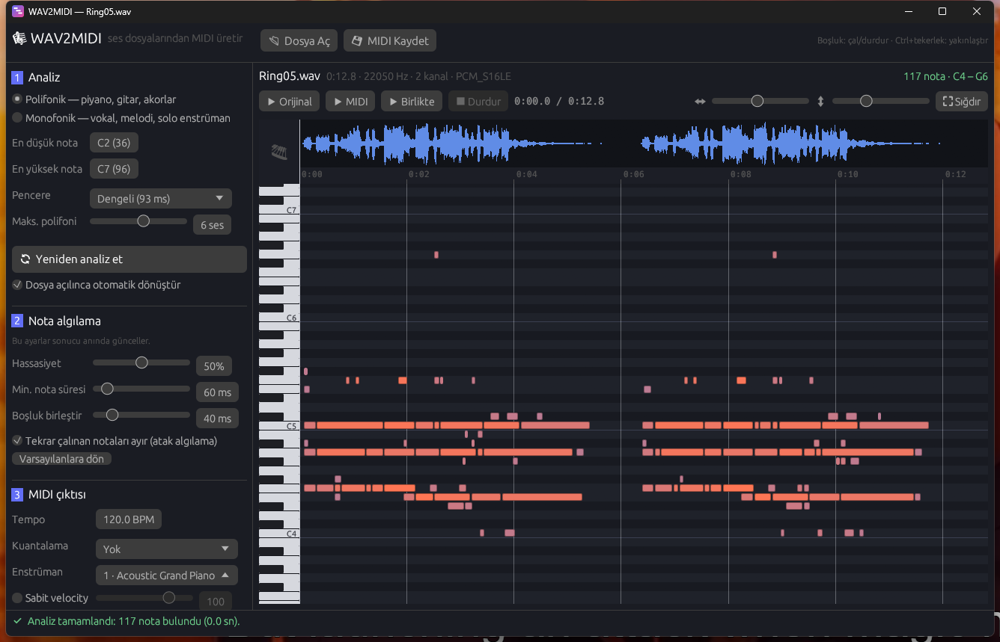

# 🎼 WAV2MIDI

WAV / MP3 ses dosyalarını MIDI'ye dönüştüren, tamamen **Rust** ile yazılmış masaüstü uygulaması.
Yapay zekâ modeli ya da harici program gerektirmez; analiz tamamen sinyal işleme ile, yerelde yapılır.



## Özellikler

- **Desteklenen formatlar:** WAV, MP3, FLAC, OGG/Vorbis, M4A/AAC
- **İki analiz modu**
  - **Polifonik**: piyano, gitar, akorlar (aynı anda en fazla 10 nota)
  - **Monofonik**: vokal, ıslık, flüt, keman gibi tek sesli kayıtlar
- **Anlık ayar**: hassasiyet, minimum nota süresi, boşluk birleştirme ve atak algılama kaydırıcıları sonucu yeniden analiz gerektirmeden anında günceller
- **Piyano rulosu**: dalga formu, zaman cetveli, yakınlaştırma/kaydırma, nota üzerine gelince bilgi
- **Dinleme**: orijinal ses, sentezlenmiş MIDI veya ikisi birlikte (hizalamayı kulakla kontrol etmek için)
- **MIDI çıktısı**: tempo (BPM), kuantalama (1/4 – 1/32), 128 General MIDI enstrümanı, sabit/dinamik velocity
- Sürükle-bırak, `Ctrl+O` / `Ctrl+S` / `Boşluk` / `Enter` kısayolları
- Tek dosya, kurulum gerektirmeyen `.exe`

## Kullanım

1. [Releases](../../releases) sayfasından `wav2midi.exe` dosyasını indirip çalıştırın.
2. Bir ses dosyasını pencereye sürükleyin veya **Dosya Aç** ile seçin. Dosya otomatik analiz edilir.
3. Kayda uygun modu seçin (*Polifonik* / *Monofonik*) ve gerekirse **Yeniden analiz et**'e basın.
4. **Nota algılama** kaydırıcılarıyla sonucu ince ayarlayın, **▶ Birlikte** ile dinleyerek kontrol edin.
5. **MIDI Kaydet** ile `.mid` dosyasını kaydedin.

| Kısayol | İşlev |
|---|---|
| `Ctrl+O` | Dosya aç |
| `Ctrl+S` | MIDI kaydet |
| `Enter` | Yeniden analiz et |
| `Boşluk` | Çal / durdur |
| `Ctrl + tekerlek` | Yatay yakınlaştır |
| Tekerlek / sürükleme | Rulo üzerinde gezin |
| Tıklama | Çalma konumunu seç |

### İyi sonuç için ipuçları

- En iyi sonuç **tek enstrümanlı, davulsuz** kayıtlarda alınır. Tam bir şarkı miksi (davul + bas + vokal) dönüştürülebilir ama sonuç karışık olur.
- Vokal ve solo melodiler için **Monofonik** mod çok daha temiz sonuç verir.
- Gereksiz kısa notalar varsa **hassasiyeti düşürün** veya **min. nota süresini** artırın.
- Bas notaları ya da yavaş parçalar için polifonik modda **Pencere: Hassas** seçeneğini deneyin; hızlı pasajlar için **Hızlı**'yı kullanın.

## Nasıl çalışır?

| Aşama | Yöntem |
|---|---|
| Ses çözme | [symphonia](https://github.com/pdeljanov/Symphonia) — tümü Rust, mono'ya indirgeme |
| Monofonik perde | **YIN** algoritması (FFT tabanlı fark fonksiyonu, parabolik ara değerleme), medyan filtre, histerezisli nota bölütleme |
| Polifonik perde | Klapuri (2006) tarzı **harmonik genlik toplama**: Hann pencereli STFT → spektral beyazlatma → ağırlıklı harmonik salience → yinelemeli tahmin ve *spektral düzgünlük* ile harmonik çıkarma |
| Atak algılama | Kısa pencereli spektral akı (spectral flux) + tepe seçimi; nota başlangıçları ataklara hizalanır, tekrar çalınan notalar bölünür |
| MIDI | Bağımlılıksız SMF format 1 yazıcı (480 PPQ, tempo + ölçü izi, nota izi) |
| Arayüz | [egui / eframe](https://github.com/emilk/egui), dosya diyaloğu için [rfd](https://github.com/PolyMeilex/rfd), çalma için [rodio](https://github.com/RustAudio/rodio) |

Ağır analiz kare kare [rayon](https://github.com/rayon-rs/rayon) ile paralel yapılır; birkaç dakikalık bir dosya genellikle birkaç saniyede analiz edilir.
Analiz sonucu önbellekte tutulduğundan, nota takibi ayarları kaydırıcılar oynatıldıkça anında yeniden hesaplanır.

## Kaynaktan derleme

[Rust](https://rustup.rs) (stable) gerekir. Windows'ta MSVC araç zinciri kullanılır.

```bash
cargo build --release
```

Çıktı: `target/release/wav2midi.exe`

Testleri çalıştırmak için (sentetik melodi ve akorlarla uçtan uca doğrulama):

```bash
cargo test --release
```

### Proje yapısı

```
src/
  lib.rs            çekirdek kütüphane
  audio.rs          ses çözme (symphonia)
  analysis/
    mono.rs         YIN + monofonik nota takibi
    poly.rs         çoklu perde tahmini + polifonik nota takibi
    util.rs         yardımcılar (pencere, yüzdelik, tepe seçimi)
  midi.rs           SMF yazıcı
  synth.rs          önizleme sentezleyicisi
  notes.rs          Nota türü, nota adları
  main.rs / app.rs  egui arayüzü
  piano_roll.rs     piyano rulosu bileşeni
  player.rs         ses çalma
  gm.rs             General MIDI enstrüman listesi
tests/pipeline.rs   uçtan uca testler
```

## Sınırlamalar

- Polifonik transkripsiyon zor bir problemdir: aynı anda çalan oktav notaları, yoğun miksler ve davullar hatalı/eksik notalara yol açabilir.
- Tempo otomatik algılanmaz; MIDI dosyası seçtiğiniz BPM ile yazılır (notaların gerçek zamanlaması her durumda korunur).
- Pitch bend / perde kayması MIDI'ye aktarılmaz; notalar en yakın yarım tona yuvarlanır.

## Lisans

[MIT](LICENSE)
